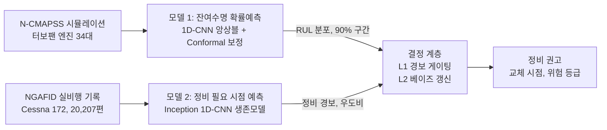
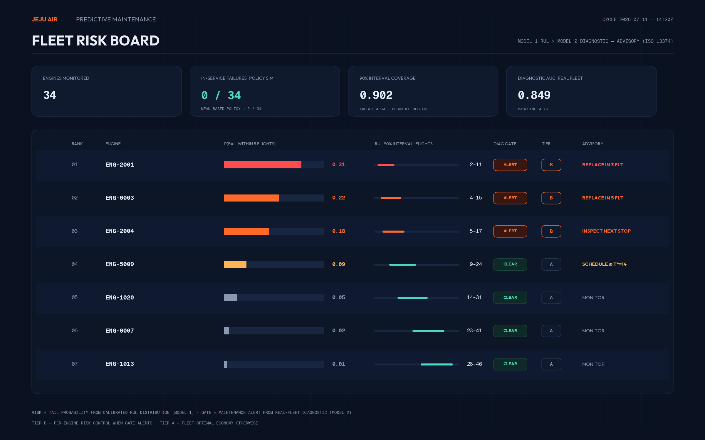

# 제주항공 엔진 예지정비 AI PoC

항공기 엔진 센서 데이터로 **잔여수명(RUL)을 확률분포로 예측**하고, 실제 비행기록 기반 **정비진단 모델**과 결합해 "언제 정비할 것인가"를 비용과 위험 기준으로 결정하는 예지정비(Predictive Maintenance) 개념검증 프로젝트입니다.

| 항목 | 내용 |
|---|---|
| 프로그램 | 미래내일 일경험 프로젝트형 2차 에어로AI트랙 (항공우주산학융합원 · 제주항공) |
| 기간 / 인원 | 2026년 6월 ~ 7월 (8주) / 4인 팀 (팀장) |
| 수상 | 에어로AI트랙 경진대회 동상 (2026.07) |
| 데이터 | NASA N-CMAPSS 터보팬 시뮬레이션 (엔진 34대), NGAFID 실비행 정비 데이터 (20,207편) |
| 주요 기법 | 1D-CNN 앙상블, 이산시간 생존모델, Conformal 예측, 뉴스벤더 기반 정비 결정, 베이즈 우도비 융합 |
| 환경 | Python, PyTorch, scikit-learn, Google Colab (GPU) |

## 담당 역할

4인 팀의 **팀장**으로 결과보고서 작성과 저장소 정리를 맡았고, **모델 1의 초기 모델 탐색과 검증**을 담당했습니다. 비행 클래스별 앙상블·CNN-LSTM 베이스라인에서 "LCC 단거리 데이터에 가중치를 주면 성능이 오른다"는 가설을 실험해 15~20% 개선을 얻었지만, 결과가 기대보다 크게 벗어나는 것을 보고 평가 과정을 재점검했습니다. 그 결과 스케일러와 특징선택이 테스트 데이터까지 포함해 fit되던 누수를 찾아냈고, 이를 고쳐 다시 검증하자 효과가 사라져 가설을 기각했습니다([v1.1–v1.2 기록](archive/v1.1-v1.2_leakage_fix/)). 이 발견은 최종본에서 점 예측의 정확도 대신 확률 보정과 의사결정을 평가 기준으로 삼는 계기가 되었습니다.

## 핵심 결과

| 구분 | 지표 | 결과 |
|---|---|---|
| 모델 1 (잔여수명) | 90% 예측구간 실측 커버리지 | **0.902** |
| 모델 1 (잔여수명) | 권고 교체 시점이 실제 고장보다 늦은 비율 (목표 0.10 이하) | **0.025** (엔진별 보정) / 0.119 (fleet 보정) |
| 모델 1 (잔여수명) | 정책 시뮬레이션 운항 중 고장 | **34대 중 0대** (평균 예측 기반 정책은 최선 1대) |
| 모델 2 (정비진단) | 정확도 / AUC | **0.762 / 0.849** (초기 이진 모델 0.74 / 0.76) |
| 융합 | 모델 2 경보의 우도비 (LR+ / LR-) | 2.21 / 0.154 |

모든 수치는 학습에 쓰지 않은 엔진 또는 정비 사건 그룹으로 평가했습니다. 모델 2는 같은 정비 사건의 비행이 학습과 평가에 나뉘지 않도록 사건 단위로 분할해, 비행 단위로 분할한 기존 벤치마크보다 엄격한 조건입니다.

## 문제 정의

항공 정비는 고장 후 수리(불시 결함 위험)와 정해진 주기의 예방 정비(멀쩡한 부품까지 교체하는 비용) 사이에서 균형을 찾아야 합니다. 정비 판단의 비용은 비대칭이므로(잔여수명을 길게 잘못 보면 운항 중 고장, 짧게 잘못 보면 부품 낭비), 이 프로젝트에서 **믿을 수 있는 확률분포와 그로부터 나오는 비용 최적 결정**을 얻고자 했습니다.

## 시스템 구조

서로 다른 두 데이터로 독립된 모델 2개를 학습하고, 두 모델이 같은 확률 언어(분포, 생존곡선)로 출력하도록 설계해 정비 결정 단계에서만 결합합니다. 이 구조는 ISO 13374(OSA-CBM)의 상태탐지, 건강평가, 예지평가, 권고생성 계층과 대응합니다.



**모델 1. 잔여수명 확률예측** (N-CMAPSS)
운항 조건별 정규화로 순수 열화 신호를 분리한 뒤, 1D-CNN 멀티태스크 앙상블이 RUL의 이산 확률분포를 출력합니다. 보정 전용 엔진으로 Conformal 보정을 거쳐 90% 구간을 맞추고, 분포에서 뉴스벤더 임계분위수(고장:조기교체 비용 9:1)와 갱신-보상 최적 교체시점을 계산합니다.

**모델 2. 정비 필요 시점 예측** (NGAFID)
"정비 직전 비행인가"라는 기존 이진 분류를 "앞으로 0~4일 안에 정비가 필요할 확률"을 내는 이산시간 생존모델로 재구성했습니다. 확률 출력으로 바꾸면서도 정확도와 AUC가 함께 올랐고, 경보의 민감도·특이도를 우도비로 환산해 모델 1에 전달합니다.

**결정 계층 (융합)**
L1은 모델 2가 경보하면 모델 1의 보수적 운영점(엔진별 보정), 정상이면 경제적 운영점(fleet 보정)을 쓰는 게이팅입니다. 경제적 운영점만 쓰면 임계 5사이클에서 34대 중 1대가 운항 중 고장 나지만, 경보 시 적용되는 보수적 운영점은 같은 조건에서 34대 전부를 고장 전에 정비합니다. L2는 경보를 우도비로 바꿔 열화 확률을 갱신합니다(사전 20%에서 경보 시 36%, 무경보 시 4%). 같은 엔진의 운항·정비 기록을 결합하는 L3 조인트 모델은 실데이터가 필요해 설계 방향만 정리했습니다.

<p align="center">
  
</p>
<p align="center">정책 시뮬레이션과 융합 결과를 정비 화면으로 옮긴 대시보드 목업</p>

자세한 설계, 결과, 인용 문헌은 [기술문서](final/technical_report.md)에 정리되어 있습니다.

## 개발 과정

최종 구조에 이르기까지 세 번의 큰 전환이 있었고, 각 단계의 코드와 기록은 [`archive/`](archive/)에 보존했습니다.

| 버전 | 내용 | 결과 |
|---|---|---|
| v1.0 | 비행 클래스별 앙상블(GBM+RF+MLP) / CNN-LSTM 베이스라인, LCC 운항 특성을 반영한 단거리 샘플 가중치 보정 | 단거리 RMSE 약 15% 개선 보고 |
| v1.1 – v1.2 | 평가 코드 재점검: 스케일러·특징선택을 학습 폴드 안에서만 fit하도록 수정하는 등 피드백 5건, 버그 5건 반영 | **v1.0의 개선 효과가 데이터 누수에 의한 착시였음을 확인** (누수 제거 후 가중치 효과 -1.4% ~ +1.4%) |
| v2 | 멀티헤드 CNN 하나로 RUL, 고장부위, 불확실성을 동시 예측하는 8단계 설계 | 설계 완료 후 미실행, v3로 방향 전환 |
| v3 (최종) | 모델 분리 + 확률 보정 + 결정 계층 융합 | 위 핵심 결과 |

v1.2에서 발견한 데이터 누수가 v3 설계의 출발점이 되었습니다. 점 예측의 정확도 수치는 평가 방식에 따라 쉽게 부풀려질 수 있다는 점을 확인했고, 그래서 최종본에서는 정확도보다 예측의 보정(calibration)과 그에 기반한 결정을 평가 기준으로 삼았습니다. 버전별 변경 내역은 [CHANGELOG](CHANGELOG.md)를 참고하세요.

## 저장소 구조

```
jejuairline/
├── README.md
├── CHANGELOG.md                  버전별 변경 이력
├── final/                        최종본 (v3)
│   ├── README.md                 폴더 안내
│   ├── technical_report.md       기술문서: 설계, 결과, 한계, 인용 문헌, 재현 방법
│   ├── model1_rul/               모델 1 노트북, 평가 지표(json), 예측값(npz)
│   ├── model2_diagnosis/         모델 2 노트북, 평가 지표(json), 융합 파라미터(json), 예측값(npz)
│   └── ui_mockup/                대시보드, 엔진 상세 화면 목업
└── archive/                      개발 과정 기록 (v1.0 ~ v2)
    ├── README.md                 버전별 안내와 회고
    ├── v1.0_baseline/
    ├── v1.1-v1.2_leakage_fix/
    └── v2_multitask_design/
```

## 실행 방법

모든 노트북은 Google Colab GPU 런타임 기준입니다.

1. **모델 1**: NASA [Prognostics Data Repository](https://www.nasa.gov/intelligent-systems-division/discovery-and-systems-health/pcoe/pcoe-data-set-repository/)의 "Turbofan Engine Degradation Simulation-2"에서 `N-CMAPSS_DS01-005.h5`, `DS02-006.h5`, `DS03-012.h5`를 받아 Google Drive에 올린 뒤 `final/model1_rul/model1_rul.ipynb`를 위에서부터 실행합니다. 학습은 T4 기준 약 1.5~2시간이며, 저장된 예측값(`predictions.npz`)으로 정책 시뮬레이션만 재현할 수도 있습니다.
2. **모델 2**: `final/model2_diagnosis/model2_diagnosis.ipynb`를 실행하면 NGAFID 데이터(4.3GB)를 자동으로 내려받습니다. 전처리 20~40분, 학습 40~60분이 걸립니다.

h5 파일(파일당 약 3GB)과 NGAFID 원본은 용량 때문에 저장소에 포함하지 않았습니다. 세부 절차는 [기술문서 7절](final/technical_report.md#7-재현-가이드)을 참고하세요.

## 한계

- 모델 1은 시뮬레이션 데이터 기반이고 엔진이 34대뿐이어서, 일부 엔진(LPT 계열 3대)의 체계적 편향은 보정만으로 해소되지 않습니다. 실기체 적용에는 도메인 적응과 재보정이 필요합니다.
- 모델 2는 소형기(Cessna 172) 데이터이므로, 터보팬 엔진에 쓰려면 경보의 민감도·특이도를 다시 추정해야 합니다.
- 같은 엔진에 대한 두 데이터의 공통 기록이 없어, 실제 모델 2 경보로 두 운영점을 오가는 게이팅은 검증하지 못했습니다. 또 모델 2의 특이도가 0.59로 낮아 오경보가 잦은 만큼, 게이팅은 보수적 운영점에 가깝게 동작해 비용 이득이 크지 않을 수 있습니다.
- 두 모델을 하나의 통계 모델로 묶는 L3는 같은 엔진의 운항 기록(ACARS, QAR)과 정비·샵 방문 기록이 있어야 가능해, 이번 범위에서는 다루지 못했습니다.
- 모델 2의 생존분포는 단기 정비 확률을 실제보다 낮게 예측합니다(2일 내 정비 확률 예측 0.339, 실측 0.404). 순위 성능에는 영향이 없지만 확률값을 그대로 결정에 쓰기에는 보정이 부족합니다.
- 모델 1의 RUL 라벨 상한은 50사이클로, 상한 125를 쓴 v1 계열의 RMSE와는 직접 비교할 수 없습니다.

## 참고

- Arias Chao et al. (2021). Aircraft Engine Run-to-Failure Dataset under Real Flight Conditions for Prognostics and Diagnostics. *Data*, 6(1), 5.
- Yang & Desell (2022). A Large-Scale Annotated Multivariate Time Series Aviation Maintenance Dataset from the NGAFID. arXiv:2210.07317.
- 전체 인용 문헌은 [기술문서 5절](final/technical_report.md#5-인용-문헌-역할별)에 정리되어 있습니다.

결과보고서(.hwp)와 발표자료(.pptx)는 팀원 실명이 포함된 심사 제출용 문서여서 공개하지 않았습니다.
